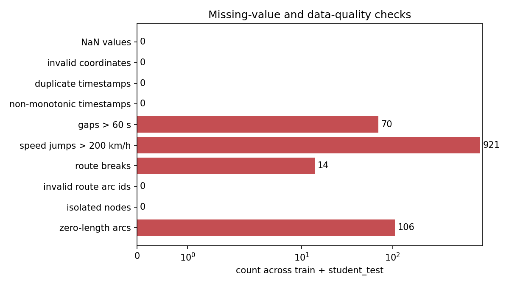
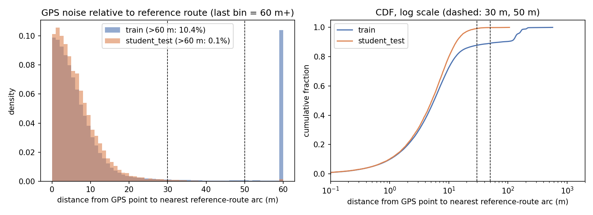
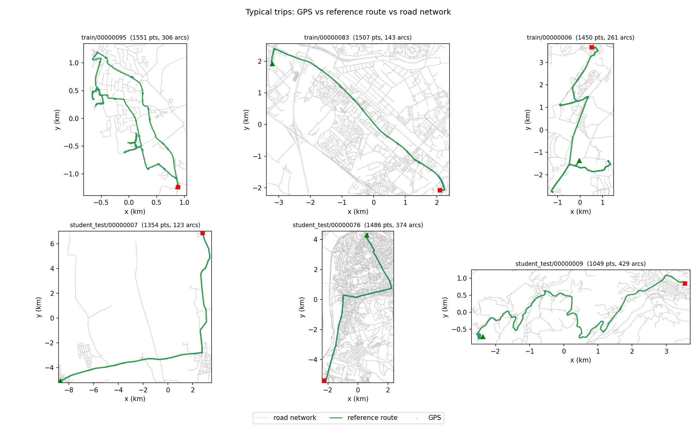
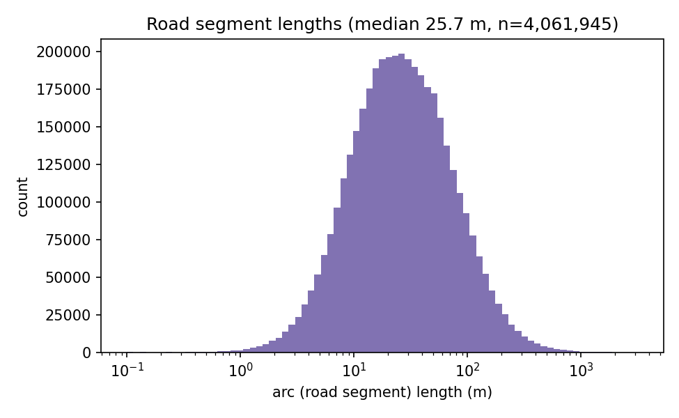
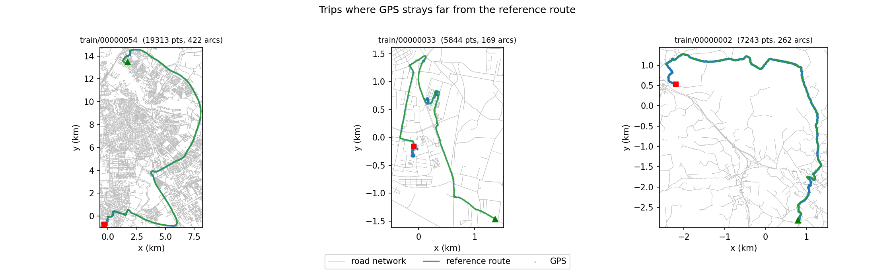
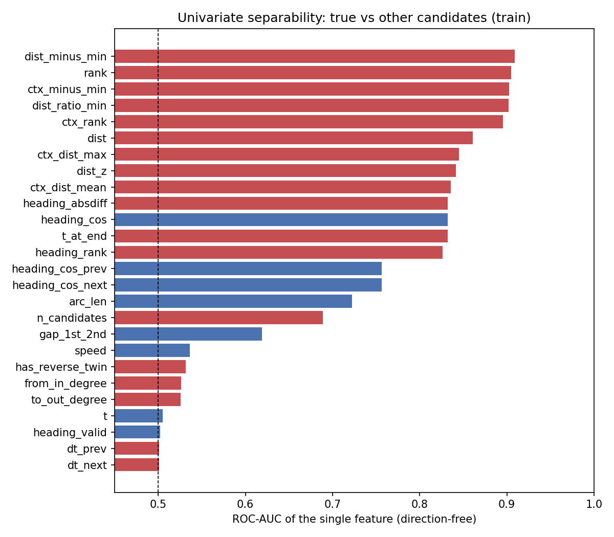

# 2. Dataset Understanding and Exploratory Data Analysis

This first-review section covers the dataset structure, the preprocessing decisions made from the available data, and the feature-engineering decisions implemented in Phase 3. The current `main` plan marks Phase 3 complete. EDA uses only `train` (80 trips) and `student_test` (10 trips). The evaluator partition was not opened or used.

## 2.1 Dataset structure

The raw data is grouped by trip. Each trip directory contains four headerless, whitespace-separated files. The row index is meaningful for the network files: a node's zero-based row number is its node ID, and an arc's zero-based row number is its arc ID. IDs are local to each trip's network.

| File | Rows and meaning | Role in the pipeline |
|---|---|---|
| `.track` | Longitude, latitude, timestamp in seconds | Ordered GPS observations of the vehicle |
| `.nodes` | Longitude, latitude | Road-network node coordinates |
| `.arcs` | Integer `from_node_id`, `to_node_id` pairs | Directed road segments connecting rows in `.nodes` |
| `.route` | Ordered integer arc IDs | Supplied reference route: an ordered sequence of rows from `.arcs` |

*Table 1. Raw trip files, columns, and the identifiers used to relate them. Source: `src/pathsnap/io.py` and Dataset Exploration, “Raw File Types.”*

The relationship is GPS point → nearby candidate arc → ordered route. The route is not a per-point label file: it is an ordered list of arcs, and the trip-level median is about five GPS observations per route arc. We therefore do not pair row *i* in `.track` with row *i* in `.route`. Phase 2 implements an order-preserving dynamic-programming alignment from GPS observations to positions in the route arc sequence. Route position cannot move backwards; the alignment balances point-to-arc distance with route progress versus GPS displacement. Points more than 50 m from every route arc remain unlabelled and are omitted from model training and point-level metrics.

### Inventory

All expected files are present in both analyzed partitions. The table reports exact byte and row totals from `eda_file_inventory.csv`; rows are summed across the trips in that split.

| Split | Trips | Files present | File type | Total size (bytes) | Total rows |
|---|---:|---:|---|---:|---:|
| train | 80 | 80 | `.track` | 6,872,352 | 208,417 |
| train | 80 | 80 | `.nodes` | 38,431,647 | 1,933,485 |
| train | 80 | 80 | `.arcs` | 44,267,751 | 3,876,904 |
| train | 80 | 80 | `.route` | 165,702 | 31,336 |
| student_test | 10 | 10 | `.track` | 625,911 | 19,160 |
| student_test | 10 | 10 | `.nodes` | 1,822,179 | 90,689 |
| student_test | 10 | 10 | `.arcs` | 1,902,157 | 185,041 |
| student_test | 10 | 10 | `.route` | 18,344 | 3,477 |

*Table 2. File inventory by split and file type. There are 320 files in train and 40 in student_test, with one file of each type per trip. Source: `results/logs/eda_file_inventory.csv`; aggregates are reproducible with `results/verify_section2.py`.*

Each trip has its own network, so node and arc IDs must never be interpreted across trip directories. The route sequence refers to arc IDs in that trip's `.arcs` file. In the analyzed data the per-trip median ratio of GPS observations to route arcs is 5.289222 in train and 4.634907 in student_test; neither value implies a direct one-to-one label mapping.

## 2.2 Preprocessing and data-quality decisions

`scripts/eda.py` loads the headerless files with explicit columns and numeric types, then checks missing values, coordinate plausibility, timestamp order, network references, route IDs, geometry, and connectivity. Geometric calculations use a trip-centred local equirectangular projection in metres. We do not use Euclidean distances in raw longitude/latitude degrees: degrees are angular units, not consistent ground distances. The implementation describes the projection error as below 0.1% over a 20 km scale and uses a Haversine helper for cross-checks. At the scale of these trips this is small relative to the tens-of-metres candidate search; the same projection is used for GPS points, nodes, and arc distances.

| Check over train + student_test | Count | Preprocessing decision |
|---|---:|---|
| NaN values | 0 | No missing-value imputation was needed in the inspected fields |
| Invalid coordinates | 0 | No coordinate rows were removed |
| Duplicate timestamps | 0 | Keep timestamp order as supplied |
| Non-monotonic timestamps | 0 | No timestamp reordering was needed |
| Invalid route arc IDs | 0 | All supplied route IDs index an arc in that trip |
| Isolated nodes | 0 | No isolated nodes were found by the network check |
| Zero-length arcs | 106 | Retain, but treat as zero geometric length |
| Route breaks | 14 | Preserve the ordered route; do not assume each adjacent pair is connected |
| Steps implying speed above 200 km/h | 921 | Keep the observations; Phase 3 includes speed and adjacent time intervals, but no separate jump-size column |

*Table 3. Missing-value and structural checks across both analyzed partitions. Source: `results/figures/eda_data_quality.png`, `results/logs/eda_trip_summary.csv`, and `results/logs/eda_notes.md`.*

*Figure 1. Counts of missing and flagged structural values across train and student_test. Zero-count bars are checks that passed; zero-length arcs and route breaks are retained as observed data conditions. Source: `results/figures/eda_data_quality.png`.*

Sampling is nominally one observation per second. The median, across trips, of the fraction of exact one-second intervals is 0.990979 in train and 0.999323 in student_test. Gaps longer than 60 s occur in 23 train trips and 1 student_test trip; the longest observed gap is 153,064 s in train trip `00000090`. We will split trajectories at large gaps and decode each segment independently, while retaining a time-gap feature. The interval and speed plots show why deleting all high-speed transitions would be unsafe: some are GPS jumps, but some may be plausible high-speed driving.

*Figure 2. Sampling-interval counts and the distribution of intervals longer than 5 s, pooled across train and student_test. Source: `results/figures/eda_sampling_intervals.png`.*

*Figure 3. Speed between consecutive GPS observations, clipped at 200 km/h for display. The 921 above-threshold steps are retained rather than deleted. Source: `results/figures/eda_speed_distribution.png` and `results/logs/eda_trip_summary.csv`.*

GPS-to-route distance provides the candidate-search scale. Across trips, the median of per-trip median distances is 4.498225 m in train and 4.593247 m in student_test. The corresponding medians of per-trip 95th-percentile distances are 14.216592 m and 15.768227 m. Most ordinary observations are close to the reference route, but a few trips are not. EDA suggested a 30–50 m search scale. Phase 2 then swept the candidate settings and selected a 50 m radius with a maximum of 12 candidates per point.

*Figure 4. Pooled GPS-to-reference-route distances for train and student_test; the vertical guides mark 30 m and 50 m. Source: `results/figures/eda_gps_to_route_distance.png`.*

| Split | Labelled-point fraction | Mean candidates per labelled point | Candidate miss rate |
|---|---:|---:|---:|
| train | 0.8917314806373761 | 7.188660869939522 | 0.005902546111960054 |
| student_test | 0.9985908141962422 | 7.8111116918413215 | 0.0006794543458945278 |

*Table 4. Phase 2 candidate summary at the selected 50 m radius and 12-candidate limit. Miss rate is the fraction of labelled points whose true arc is absent from the generated candidates. Source: `results/logs/candidate_summary.csv`.*

*Figure 5. Three typical train trips and three typical student_test trips, selected by closeness to each split's median GPS-point count. Blue marks GPS observations, green shows the reference route, and grey shows nearby road-network arcs. Source: `results/figures/eda_trajectories_typical.png`.*

*Figure 6. GPS-point counts per trip and the relationship between GPS observations and reference-route arc counts in train and student_test. Source: `results/figures/eda_points_per_trip.png`.*

The network checks show a large, mostly connected directed graph with some structural exceptions. The train median is 9,608 nodes and 19,526.5 arcs per trip; the median weak-component count is 20 and the median largest strongly connected component covers 0.964191 of nodes. About 95% of arcs have a reverse twin. Duplicate directed arcs occur in the data (median 2.5 per trip, maximum 322); since they have the same endpoints, the label builder canonicalizes duplicate arc IDs and Phase 3 treats them as the same road. A reverse twin is not assumed for every road. Directed connectivity also means some candidate transitions can be unreachable; the later route decoder needs a fallback for those pairs. The route list has 14 breaks in total, where consecutive reference arcs do not share a node.

*Figure 7. Node and arc counts, weakly connected components, and largest strongly connected component fraction per trip in train and student_test. Source: `results/figures/eda_network_connectivity.png`.*

*Figure 8. Arc lengths computed between endpoint nodes in projected metres; the horizontal scale is logarithmic. Source: `results/figures/eda_arc_length.png`.*

### Trips where the reference route does not explain the GPS

The anomaly checks distinguish a route that skips part of the drive from a road that is absent from the supplied network. For train trip `00000033`, many GPS points are far from the reference route but close to another network arc: this indicates that the route skips roads used by the drive. For `00000054`, those points are also far from every network arc, indicating missing network geometry. Trips `00000002` and `00000096` show a similar missing-road pattern near the end. We keep these trips, but follow the EDA decision to leave points more than 50 m from the reference route unlabelled after order-preserving alignment. This avoids forcing a route-derived label onto points the route does not explain.

| Train trip | Points more than 50 m from route | Median distance from those points to any network arc | EDA interpretation |
|---|---:|---:|---|
| `00000054` | 87% | 86 m | Road missing from the network; GPS follows a ring road about 100 m from any arc |
| `00000033` | 59% | 7 m | GPS follows other network roads; reference route skips part of the drive |
| `00000002` | 12%, mostly the last 552 points | 56 m | Road missing, mostly at the end |
| `00000043` | 7% | 27 m | Mixed case |
| `00000096` | 4%, last 145 points | 76 m | Road missing at the end |

*Table 5. The five largest route-distance anomalies identified in train. Percentages and interpretations are reported as in the EDA notes; distances are medians for far points. Source: `results/logs/eda_notes.md` and `results/logs/eda_anomalies.csv`.*

*Figure 9. The three trips with the highest fraction of GPS points more than 50 m from their reference route. Source: `results/figures/eda_trajectories_anomalies.png`.*

*Figure 10. GPS-to-reference-route distance over each selected anomalous trip; the dashed line marks the 50 m EDA threshold. Source: `results/figures/eda_anomaly_distance_over_time.png`.*

The interactive map for the typical train example is available at [`eda_train_00000095.html`](../results/maps/eda_train_00000095.html). It has separate layers for nearby road arcs, reference route, and GPS observations, plus a visible legend and layer control. The browser screenshot requested for the report has not been captured in this draft because the available Windows browser automation targeted an inconsistent window.

### Assumptions and limitations

The supplied route is a reference, not independently verified, error-free ground truth. The GPS can be noisy, the network can omit roads, and the reference route can skip roads that appear in the network. The 50 m label cutoff and the Phase 2 candidate setting (50 m, at most 12 candidates) are practical choices, not claims that all remaining labels are certainly correct. Phase 3 feature extraction is implemented; Phase 4 classifier comparison has not been completed.

## 2.3 Phase 3 feature-engineering decisions

Phase 3 is implemented in `src/pathsnap/features.py` and built with `python -m scripts.build_features`. It creates 26 features for each GPS-point/candidate-arc pair, in six groups. The feature code uses the GPS track and network geometry; it does not read the reference route, so the same feature function can run where route labels are unavailable.

| Implemented group | Feature columns | Why these are used |
|---|---|---|
| Distance | `dist`, `rank`, `dist_minus_min`, `dist_ratio_min`, `dist_z`, `n_candidates`, `gap_1st_2nd` | GPS is usually close to the right arc, but the distance relative to other candidates and the gap between the nearest choices captures ambiguity and trip-to-trip noise variation. |
| Projection | `t`, `t_at_end`, `arc_len` | A projection at an arc endpoint can signal that the observation lies beyond that segment; arc length supplies the local segment scale. |
| Heading | `heading_cos`, `heading_absdiff`, `heading_cos_prev`, `heading_cos_next`, `heading_rank`, `heading_valid` | Reverse twins have the same geometric distance, so direction helps distinguish opposite travel directions. Heading is calculated over nearby samples, with a validity flag for insufficient displacement. |
| Context | `ctx_dist_mean`, `ctx_dist_max`, `ctx_minus_min`, `ctx_rank` | A candidate that also fits neighbouring GPS points is less likely to be a one-point geometric coincidence. Context uses points from two steps before through two steps after, with each arc extended 30 m at both ends for this calculation. |
| Motion | `speed`, `dt_prev`, `dt_next` | Speed and adjacent sample intervals describe movement and gaps; they help interpret heading and context where timing is irregular. |
| Network | `from_in_degree`, `to_out_degree`, `has_reverse_twin` | Degree features describe local topology, and the reverse-twin flag identifies a common source of equal-distance directional ambiguity. |

*Table 6. Implemented Phase 3 features and their rationale. Feature names and implementation details come from `src/pathsnap/features.py`; rationales are documented in `results/logs/phase3_notes.md` and relate to the EDA findings above.*

The feature analysis was run on labelled train candidate rows. The strongest individual signals were relative distance features: `dist_minus_min` has absolute AUC 0.90915584, `rank` 0.90462443, and `ctx_minus_min` 0.90270653. `heading_cos` has absolute AUC 0.83216264. Speed alone has absolute AUC 0.53624952, and the degree columns are also weak individually; Phase 3 notes retain them because their value may come from interactions, such as trusting heading only when the GPS movement is informative. These are univariate results, not model-selection or cross-validation results.

*Figure 11. Absolute univariate AUC by feature on labelled train points; higher values indicate more separation when that feature is considered alone. Source: `results/figures/feature_univariate_auc.png` and `results/logs/feature_univariate.csv`.*

The label is binary (`is_true`): whether a candidate is the observation's labelled arc. Duplicate arcs count as the same road. Rows from unlabelled observations are excluded. Candidate scoring and normalization are the planned model interface: Phase 4 will select the highest-scoring arc per point for Top-1 accuracy and normalize scores per point for later HMM emission probabilities. The classifier comparison phase has not yet been completed.

## Number trail

The values below include the data counts and thresholds stated in the prose and tables. Table 2 contains the exact byte and row totals by split and file type. Figure axes and plotted thresholds are sourced by the captions under Figures 1–11.

| Values used | Source file(s) |
|---|---|
| 80 train trips; 10 student_test trips; 4 raw files per trip; 320 train files and 40 student_test files; every per-type byte and row total in Table 2 | `results/logs/eda_file_inventory.csv`; `results/section2_inventory_summary.csv` |
| 3 track columns; 2 node columns; 2 arc columns; 1 route column; zero-based row IDs; about five GPS observations per route arc; train ratio 5.289222 and student_test ratio 4.634907 | `src/pathsnap/io.py`; Dataset Exploration, “Raw File Types”; `results/logs/eda_trip_summary.csv`; `results/logs/eda_split_summary.csv` |
| 0 NaNs; 0 invalid coordinates; 0 duplicate timestamps; 0 non-monotonic timestamps; 0 invalid route IDs; 0 isolated nodes; 106 zero-length arcs; 14 route breaks; 921 steps above 200 km/h | `results/figures/eda_data_quality.png`; `results/logs/eda_trip_summary.csv`; `results/logs/eda_notes.md` |
| Projection error bound 0.1% over 20 km | `src/pathsnap/geo.py` |
| Per-trip median fractions of exact one-second intervals: 0.990979 (train), 0.999323 (student_test); gaps over 60 s in 23 train trips and 1 student_test trip; maximum gap 153,064 s in train/00000090 | `results/logs/eda_split_summary.csv`; `results/logs/eda_trip_summary.csv`; `results/logs/eda_notes.md` |
| Per-trip median GPS-to-route distance 4.498225 m (train), 4.593247 m (student_test); per-trip median 95th-percentile distance 14.216592 m (train), 15.768227 m (student_test); EDA candidate range 30–50 m; selected radius 50 m and candidate limit 12; alignment cutoff 50 m | `results/logs/eda_split_summary.csv`; `results/logs/eda_notes.md`; `results/logs/candidate_summary.csv`; `results/logs/phase2_notes.md`; `src/pathsnap/labels.py` |
| Selected-setting label fractions, mean candidates, and miss rates in Table 4 | `results/logs/candidate_summary.csv` |
| Train median network size 9,608 nodes and 19,526.5 arcs per trip; 20 weak components per trip; largest SCC fraction 0.964191; approximately 95% reverse twins; duplicate arcs median 2.5 per trip, maximum 322 | `results/logs/eda_split_summary.csv`; `results/logs/eda_notes.md`; `src/pathsnap/network.py` |
| Anomaly rows: 00000054 (87%, 86 m, ring road about 100 m from arcs); 00000033 (59%, 7 m); 00000002 (12%, last 552 points, 56 m); 00000043 (7%, 27 m); 00000096 (4%, last 145 points, 76 m) | `results/logs/eda_notes.md`; `results/logs/eda_anomalies.csv` |
| Figure sample counts: 3 typical trips in each split and 3 worst anomalies; plotted thresholds 5 s, 30 m, 50 m, and 200 km/h | `scripts/eda.py`; Figures 2–5 and 9–10; captions above |
| 26 implemented features in 6 groups; 30 m context extension; 2-step heading/context window; univariate absolute AUC values 0.90915584, 0.90462443, 0.90270653, 0.83216264, 0.53624952 | `src/pathsnap/features.py`; `results/logs/feature_univariate.csv`; `results/logs/phase3_notes.md`; `PLAN.md`, Phase 3 |
| Binary target `is_true`; per-point probability normalization | `src/pathsnap/features.py`; `results/logs/phase3_notes.md`; `PLAN.md`, Phase 3 |

*Table 7. Number registry for the section. Exact split inventory byte/row values appear in Table 2; chart tick values are visible in the referenced source figures.*
